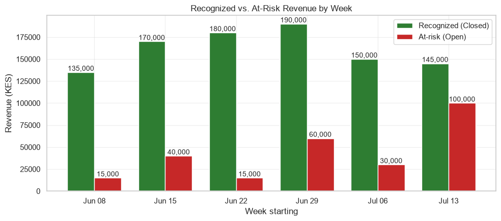
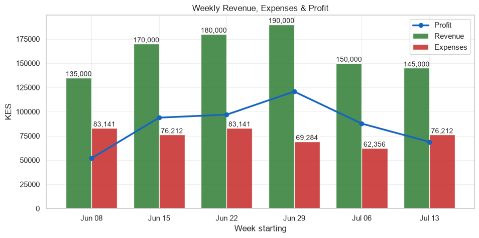
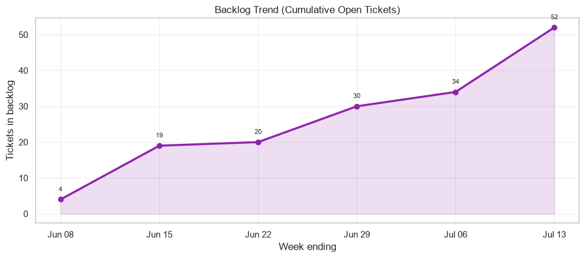
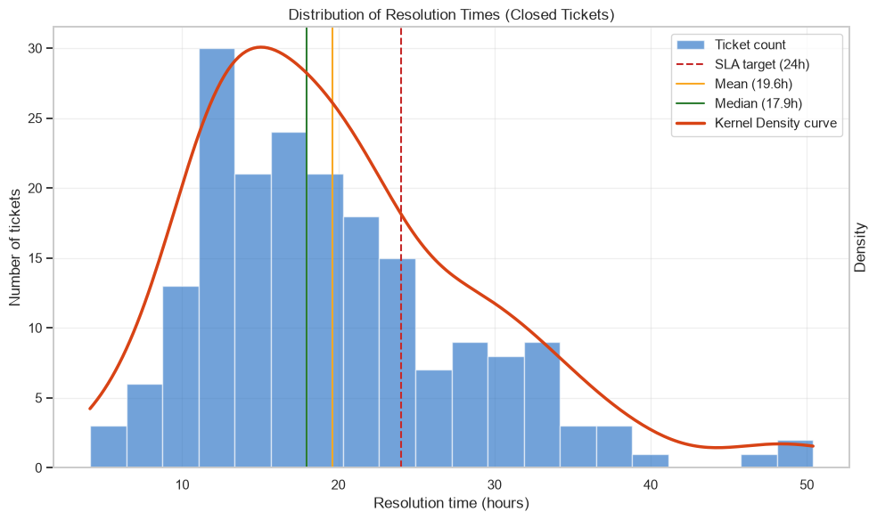
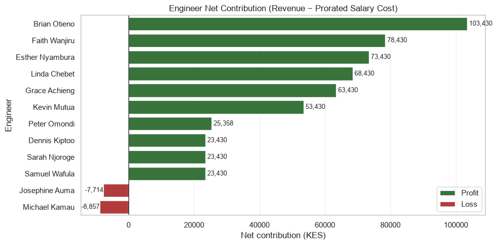
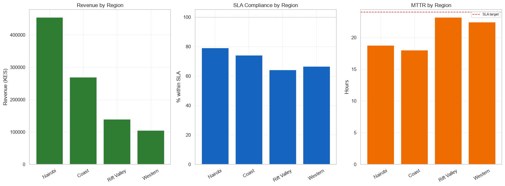
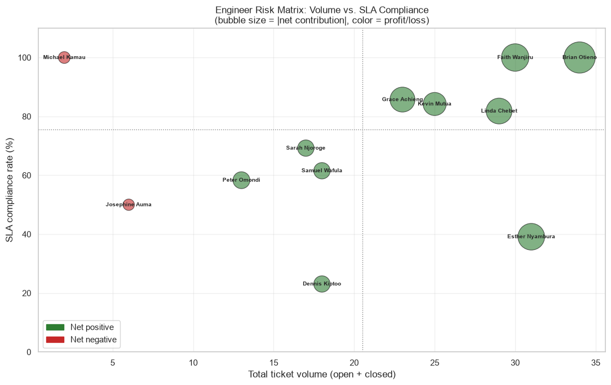

# ISP Field Operations Analytics

A financial and operational performance analysis of six weeks of field-operations ticket data from an ISP (installations, repairs and relocations). Built as a take-home data analyst assessment, the goal was to turn raw work-order tickets into a story an operations lead could act on: is the business profitable, where is the operational risk, and what should be done next week?

Everything is in one notebook, [`isp_field_ops_analysis.ipynb`](isp_field_ops_analysis.ipynb), organised into sections A–G plus a bonus section. All charts render in the notebook on GitHub.

## Headline findings

| Metric | Result |
|---|---|
| Tickets analysed | 246 (194 closed, 52 open) over 6 weeks (8 Jun – 19 Jul 2026) |
| Recognized revenue (closed tickets only) | KES 970,000 |
| At-risk revenue (open tickets) | KES 260,000 (26.8% of recognized revenue) |
| Salary expenses (prorated, active engineers only) | KES 450,346 |
| Profit | KES 519,654 |
| Mean time to resolution (MTTR) | 19.6 hours (median 17.9h) |
| SLA compliance (≤ 24h) | 74.2% (50 of 194 closed tickets breached) |
| Backlog | Grew every week, from 4 to 52 open tickets |
| Engineers net positive | 10 of 12 |

**The short version:** the business is profitable, but the backlog is growing faster than the team closes tickets. Resolution speed on any individual ticket is stable, which points to a **capacity problem rather than a speed problem**. Left alone, recognized revenue keeps converting into at-risk revenue.

### Key charts







<details>
<summary>More charts</summary>









</details>

## What the analysis covers

| Section | Topic | What it answers |
|---|---|---|
| **A** | Setup & data quality | Loads data and config, checks nulls, open/closed split, derives Monday-start weeks |
| **B** | Revenue, expenses & profit | Weekly revenue, at-risk revenue, salary expenses, profit, week-over-week change, cumulative profit, next-week revenue projection |
| **C** | SLA & MTTR | Overall and weekly MTTR, SLA compliance, resolution-time distribution and outliers, backlog trend |
| **D** | Engineer performance | Volume, net contribution (revenue − salary cost), SLA vs workload, written staffing recommendation |
| **E** | Recurring accounts | Which accounts raise repeat tickets and what that might mean operationally |
| **F** | Regional view | Revenue, SLA and MTTR by region, with a recommendation on where to add an engineer |
| **G** | Synthesis | Two-minute summary for an operations lead |
| **Bonus** | Extra investigation | Recurring accounts by region and issue type, engineer risk matrix, engineer × region heatmap |

## Selected insights

- **Backlog, not speed, is the problem.** Weekly MTTR sits between roughly 18 and 21 hours with no sustained trend, yet the backlog climbed from 4 to 52 tickets. Demand is outpacing throughput.
- **Rift Valley is the weakest region.** It has the lowest SLA compliance (64.3%) and the highest MTTR (23.2h, close to the 24h ceiling). Western is a close second (66.7%, 22.5h). Eight of the 12 engineers have worked Rift Valley tickets, so this looks structural (routing, distance, infrastructure) rather than one engineer's shortfall.
- **Two engineers stand out on SLA risk.** Dennis Kiptoo has the lowest compliance (23.1%) and owns all three IQR outliers (46–50h resolutions, spread across three regions). He works across all four regions, which suggests dispatch or travel time as a hypothesis to investigate. Esther Nyambura has the second-highest ticket volume with 39.1% compliance, so a large share of team workload is being delivered below SLA.
- **Strongest performers.** Brian Otieno and Faith Wanjiru each hold 100% SLA compliance on the highest volumes (29 and 24 closed tickets), with Brian also the top net contributor (about KES 103k).
- **Repeat tickets cluster by issue type, not region.** 15 accounts (6.8%) generate 16.3% of tickets. Among those tickets, Repair (50%) and Installation (47.5%) dominate while Relocation is just 2.5%, pointing at first-time-fix and installation quality rather than any one area.
- **Revenue is flat.** A linear fit has effectively zero slope (projection KES 161,667), while a 2-week moving average gives KES 147,500. The notebook treats the moving average as the more honest estimate for a series with no real trend.

## Methodology and assumptions

- **Config over hardcoding.** Pricing, salary, weeks-per-month and SLA target are read from `business_assumptions.json` at runtime, never typed into formulas.
- **Revenue recognition.** Only tickets with `status == "Closed"` count as revenue. Open tickets are treated as at-risk revenue.
- **Weeks.** Monday-start weeks are derived from `created_date`. All weekly figures (revenue, MTTR, SLA compliance, active engineers) are therefore attributed to the week a ticket was *created*, so weekly revenue is the value of tickets from that week that have since closed.
- **Salary cost.** Weekly salary = monthly salary ÷ weeks per month. An engineer is "active" in a week if they have at least one ticket created that week, and costs one weekly salary per active week.
- **Missing data.** Nulls in `closed_date` and `resolution_hours` match the 52 open tickets exactly (asserted in code) and are never filled with zeros. The first week's week-over-week change is left as `NaN` rather than 0.
- **SLA.** A ticket is compliant if `resolution_hours <= sla_target_hours`.
- **Outliers.** Flagged using Tukey's 1.5 × IQR fences.
- **Backlog.** Cumulative tickets created minus cumulative tickets closed by the end of each week. The final week extends to the latest timestamp in the data.

## Limitations

- Six weeks is a short window. Individual engineer conclusions (for example Michael Kamau's 100% SLA rate on 1 closed ticket) are small-sample artifacts and should be read as hypotheses.
- There is no headcount-by-region, travel or distance data, so the Rift Valley staffing recommendation and the dispatch hypothesis for Dennis Kiptoo cannot be confirmed from this dataset.
- Costs include engineer salaries only. Equipment, overheads and travel are out of scope.
- The revenue projection uses a single simple method on six data points and is illustrative, not a forecast.

## Repository structure

```
isp-field-ops-analytics/
├── isp_field_ops_analysis.ipynb   # full analysis (code, charts, written interpretation)
├── images/                        # charts exported from the notebook for this README
├── data/                          # place tickets.xlsx and business_assumptions.json here (not included)
├── requirements.txt
├── .gitignore
└── README.md
```

## Getting started

**1. Clone and install**

```bash
git clone https://github.com/akariri79/isp-field-ops-analytics.git
cd isp-field-ops-analytics
python -m venv .venv
source .venv/bin/activate        # Windows: .venv\Scripts\activate
pip install -r requirements.txt
```

**2. Add the data**

The raw data is not included in this repository (see [`data/README.md`](data/README.md)). Place these two files in the `data/` folder, which is where the notebook looks by default (`DATA_DIR = "./data"` in the first code cell):

- `tickets.xlsx` (sheet `Tickets`)
- `business_assumptions.json`

**3. Run**

```bash
jupyter lab isp_field_ops_analysis.ipynb
```

### Expected input schema

`tickets.xlsx` → sheet `Tickets`:

| Column | Description |
|---|---|
| `ticket_number` | Unique work-order ID |
| `account_number` | Customer account |
| `engineer` | Assigned field engineer |
| `region` | Coast, Nairobi, Rift Valley or Western |
| `issue_type` | Installation, Repair or Relocation |
| `created_date` | Ticket creation timestamp |
| `status` | `Open` or `Closed` |
| `closed_date` | Closure timestamp (null for open tickets) |
| `resolution_hours` | Hours to resolve (null for open tickets) |

`business_assumptions.json` keys read by the notebook: `currency`, `price_per_ticket`, `engineer_monthly_salary`, `weeks_per_month`, `sla_target_hours`.

## Tech stack

Python 3 · pandas · NumPy · matplotlib · seaborn · SciPy (KDE) · scikit-learn (linear regression) · Jupyter

## Author

**Alvin Kariri** — [GitHub @akariri79](https://github.com/akariri79)
